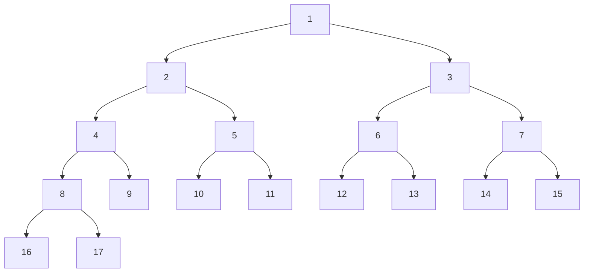
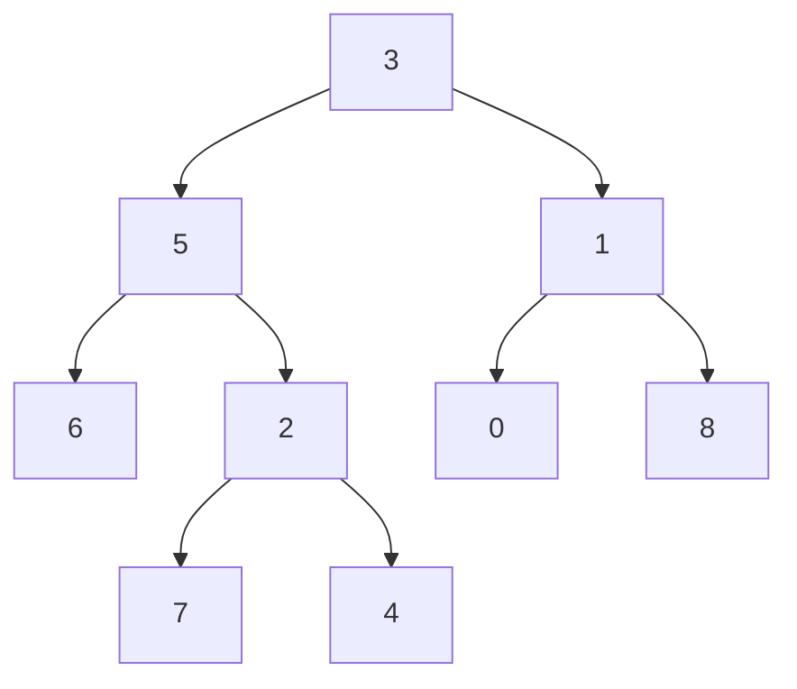
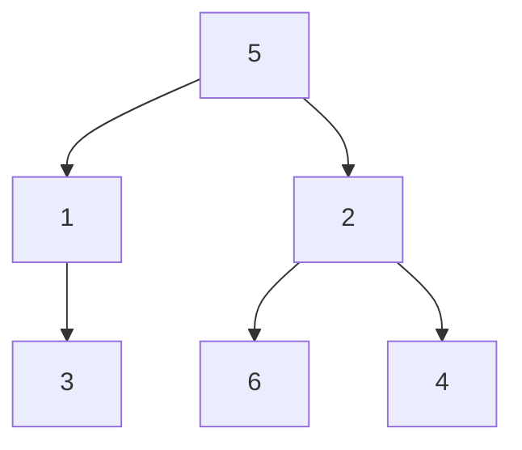
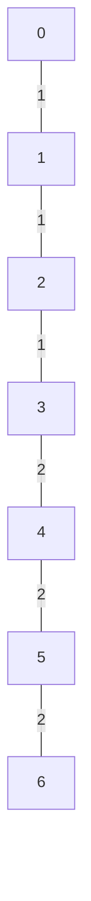

# 1. LCA, binary lifting & Ancestor Queries

## Binary lifting

Binary lifting allows us to find the `k-th ancestor` of a node in `O(log N)` time instead of `O(k)`

Imagine a rooted tree. For every node v, define:

>           up[v][j] = ancestor of v at distance 2^j

This gives you the following table:
- up[v][0] = the parent of v 
- up[v][1] = the grand parent of v
- up[v][2] = the parent of v at 4 step away
- up[v][3] = the parent of v at 8 step away

We can represent any integer `k` as a sum of powers of two.

For example:

`13 = 8 + 4 + 1`

The recurrence is:

>           up[v][j] = up[up[v][j-1]][j-1]

> [!IMPORTANT]
> Generally to get the kth ancestor, we 
>
>           walk the tree one step at a time in upward direction
>           so to get kth ancestor, we need to iterate k times
>           time complexity becomes O(k)
>
> But we can do in log time complexity
>
> for example to get the 4th ancestor
>
>       We jump two step from node and then again two step from that node
>       only two iteration required
>
> We use binary lifting for it, it requires O(logN) jumps

Therefore, to find the 13th ancestor, we jump:
1. 8 ancestors upward.
2. 4 ancestors upward.
3. 1 ancestor upward.


Consider the following rooted tree, with root node `1`.



For this example, we will calculate the binary lifting table for every node.

> [!IMPORTANT]
> The root is its own parent:
>
>           up[1][0] = 1    // for root node
>           This convention makes it easier to handle jumps that go above the root.
>
>
>           up[v][j] = the 2^j-th ancestor of node v
> Base case
>
>       The first ancestor of a node is its parent:
>
>       up[v][0] = parent[v]
>
> Recurrence
>
>       up[v][j] = up[up[v][j-1]][j-1]

### Why does this work?

To jump `2^j` edges upward:

1. Jump `2^(j-1)` edges upward.
2. From that ancestor, jump another `2^(j-1)` edges upward.

Therefore:

>       2^j = 2*2^(j-1) = 2^(j-1) + 2^(j-1)
>       This finds the 4th ancestor by jumping 2 edges twice.


### Binary Lifting Table

For the tree above, consider the following columns:

| Node | Parent (1) | 2nd ancestor | 4th ancestor | 8th ancestor | 16th ancestor |
|---:|---:|---:|---:|---:|---:|
| 1 | 1 | 1 | 1 | 1 | 1 |
| 2 | 1 | 1 | 1 | 1 | 1 |
| 3 | 1 | 1 | 1 | 1 | 1 |
| 4 | 2 | 1 | 1 | 1 | 1 |
| 5 | 2 | 1 | 1 | 1 | 1 |
| 6 | 3 | 1 | 1 | 1 | 1 |
| 7 | 3 | 1 | 1 | 1 | 1 |
| 8 | 4 | 2 | 1 | 1 | 1 |
| 9 | 4 | 2 | 1 | 1 | 1 |
| 10 | 5 | 2 | 1 | 1 | 1 |
| 11 | 5 | 2 | 1 | 1 | 1 |
| 12 | 6 | 3 | 1 | 1 | 1 |
| 13 | 6 | 3 | 1 | 1 | 1 |
| 14 | 7 | 3 | 1 | 1 | 1 |
| 15 | 7 | 3 | 1 | 1 | 1 |
| 16 | 8 | 4 | 1 | 1 | 1 |
| 17 | 8 | 4 | 1 | 1 | 1 |


The table is usually stored as:

`up[node][j]`

where `j` is the exponent, not the number of edges itself.


### Example: Find the 3rd Ancestor of Node 16

The path upward from node `16` is:

`16 -> 8 -> 4 -> 2 -> 1`

The 3rd ancestor is node `2`.

Using binary lifting:

`k = 3 = 2 + 1`

Binary representation:

`3 = (11)_2`

Therefore, we use the 2nd ancestor jump and the 1st ancestor jump.

Initially:

`node = 16`

The lowest set bit is bit 0:

`node = up[16][0] = 8`

The next set bit is bit 1:

`node = up[8][1] = 2`

Final answer:

`kthAncestor(16, 3) = 2`

Only two jumps were needed.

---

## 6. C++ Implementation

```cpp
class BinaryLifting {
public:
    int n, LOG;
    vector<vector<int>> up;
    vector<int> depth;

    BinaryLifting(int n) {
        this->n = n;
        this->LOG = 1;

        while((1LL << LOG) <= n) LOG++;

        up.resize(n, vector<int>(LOG, -1));
        depth.resize(n, 0);
    }

    void dfs(int u, int p, vector<vector<int>> &adj) {
        up[u][0] = p;

        for(int j=1; j<LOG; j++) 
            up[u][j] = up[up[u][j - 1]][j - 1];
            
        for(int v : adj[u]) {
            if(v == p) continue;

            depth[v] = depth[u] + 1;
            dfs(v, u, adj);
        }
    }

    int kthAncestor(int node, int k) {
        for(int j=0; j<LOG; j++) {
            if(k & (1LL<<j))
                node = up[node][j];
        }
        return node;
    }
};
```

### Important implementation notes

- Nodes in this implementation are indexed from `0` to `n-1`.
- Call `dfs(root, root, adj)` so that the root is its own parent.
- Ensure `adj` represents a tree and the DFS does not revisit the parent.
- For a very deep tree, use iterative DFS to avoid stack overflow.
- If `k` exceeds the node's depth, this implementation returns the root because the root is its own ancestor. Return `-1` instead if the problem requires it.

### Complexity Analysis

Let `N` be the number of nodes.

| Operation | Time Complexity |
|---|---|
| Build the ancestor table | `O(N log N)` |
| Find the k-th ancestor | `O(log N)` |
| Space for the ancestor table | `O(N log N)` |

The table contains `N` nodes and approximately `log2(N)` ancestor entries per node.

---

### Where Binary Lifting Is Useful
Once the ancestor table is built, it can be used for several tree problems:

1. **Kth ancestor:** Find the ancestor `k` edges above a node.
2. **LCA:** Find the lowest common ancestor of two nodes.
3. **Distance queries:** Use depths and LCA.
4. **Kth node on a path:** Combine LCA with ancestor jumps.
5. **Rerooted LCA:** Answer LCA queries when the root changes.
6. **Path aggregates:** Store minimum, maximum, sum, or other aggregate information for each jump.
---

## 2. Lowest Common Ancestor of a Binary Tree
[Leetcode link](https://leetcode.com/problems/lowest-common-ancestor-of-a-binary-tree/description)

Given a binary tree, find the lowest common ancestor (LCA) of two given nodes in the tree.

According to the definition of LCA on Wikipedia: “The lowest common ancestor is defined between two 
nodes p and q as the lowest node in T that has both p and q as descendants (where we allow a node to be a descendant of itself).”

### Standard solution
```cpp
TreeNode* lowestCommonAncestor(TreeNode* root, TreeNode* p, TreeNode* q) {
    if(!root) return NULL;

    if(root == p || root == q) return root;

    TreeNode* l = lowestCommonAncestor(root->left, p, q);
    TreeNode* r = lowestCommonAncestor(root->right, p, q);

    if(!l) return r;
    if(!r) return l;

    return root;
    }
```

### Binary lifting solution
> [!IMPORTANT]
> lca(a, b)
>
>       Fist move node a to upper side where depth[a] == depth[b]
>
>       At this point a == b, simply return a
>
>       Else decrease to depth one by one utill both nodes are same
>       Doing it one by one will be o(n)
>
>       instead binary lift them untill they are equal

```cpp
class BinaryLifting {
public:
    int n, LOG;
    vector<vector<int>> up;
    vector<int> depth;
    BinaryLifting(int n) {
        this->n = n;
        LOG = 1;

        while((1LL<<LOG) <= n) LOG++;

        up.resize(n, vector<int>(LOG, 0));
        depth.resize(n, 0);
    }

    void dfs(int u, int p, vector<vector<int>> &adj) {
        up[u][0] = p;

        for(int j=1; j<LOG; j++)
            up[u][j] = up[up[u][j-1]][j-1];
        
        for(int v : adj[u]) {
            if(v == p) continue;

            depth[v] = depth[u]+1;
            dfs(v, u, adj);
        }
    }

    int kthAncestor(int node, int k) {
        for(int j=0; j<LOG; j++){
            if((1LL<<j) & k)
                node = up[node][j];
        }

        return node;
    }

    int lca(int a, int b){
        if(depth[a] < depth[b]) swap(a, b);

        // make depth of a and b same
        int diff = depth[a] - depth[b];
        for(int j=0; j<LOG; j++) 
            if((1LL<<j) & diff)
                a = up[a][j];
        
        if(a == b) return a;

        for(int j=LOG-1; j>=0; j--) {
            if(up[a][j] != up[b][j]) {
                a = up[a][j];
                b = up[b][j];
            }
        }

        return up[a][0];
    }
};
```

---

## 3. Lowest Common Ancestor of Deepest Leaves
[Leetcode link](https://leetcode.com/problems/lowest-common-ancestor-of-deepest-leaves/description)

Given the root of a binary tree, return the lowest common ancestor of its deepest leaves.

Recall that:

The node of a binary tree is a leaf if and only if it has no children
The depth of the root of the tree is 0. if the depth of a node is d, the depth of 
each of its children is d + 1.

The lowest common ancestor of a set S of nodes, is the node A with the largest depth such that every node in S is in the subtree with root A.


- Input: root = [3,5,1,6,2,0,8,null,null,7,4]
- Output: [2,7,4]

```
Explanation: We return the node with value 2, colored in yellow in the diagram.
The nodes coloured in blue are the deepest leaf-nodes of the tree.
Note that nodes 6, 0, and 8 are also leaf nodes, but the depth of them is 2, but the depth of nodes 7 and 4 is 3.
```

### Intuition
> [!IMPORTANT]
> Run DFS from root and return two things
>
>           depth of deepest leaf and lca of that deepest leaf
>
>        auto [l, lDepth] = dfs(root->left);
>        auto [r, rDepth] = dfs(root->right);
>
>        If left tree is deepest:
>           if(lDepth > rDepth) return {l, lDepth+1};
>        If right tree is deepest:
>           if(rDepth > lDepth) return {r, rDepth+1};
>
>        If Both left and right tree are at same depth
>        Then currNode becoms the LCA:
>           return {root, lDepth+1};

```cpp
class Solution {
public:
    
    pair<TreeNode*, int> dfs(TreeNode* root) {
        if(!root) return {NULL, 0};

        auto [l, lDepth] = dfs(root->left);
        auto [r, rDepth] = dfs(root->right);

        if(lDepth > rDepth) return {l, lDepth+1};
        if(rDepth > lDepth) return {r, rDepth+1};

        return {root, lDepth+1};
    }

    TreeNode* lcaDeepestLeaves(TreeNode* root) {
        // do dfs from root
        // return depth and lca of depest leaf
        // [l, lDepth], [r, rDepth]
        //
        return dfs(root).first;
    }
};
```

---

## 4. Step-By-Step Directions From a Binary Tree Node to Another
[Leetcode link](https://leetcode.com/problems/step-by-step-directions-from-a-binary-tree-node-to-another/description)

You are given the root of a binary tree with n nodes. Each node is uniquely assigned a value from 1 to n. 
You are also given an integer startValue representing the value of the start node s, and a different 
integer destValue representing the value of the destination node t.

Find the shortest path starting from node s and ending at node t. Generate step-by-step directions of 
such path as a string consisting of only the uppercase letters 'L', 'R', and 'U'. Each letter indicates a specific direction:

'L' means to go from a node to its left child node.
'R' means to go from a node to its right child node.
'U' means to go from a node to its parent node.
Return the step-by-step directions of the shortest path from node s to node t.



- Input: root = [5,1,2,3,null,6,4], startValue = 3, destValue = 6
- Output: "UURL"
- Explanation: The shortest path is: 3 → 1 → 5 → 2 → 6.

### Intuition
> [!IMPORTANT]
> Find the LCA
>
>           path is startNode --> LCA --> endNode
>
> path from startNode --> LCA
>
>           UUUUUU....
>
> path from LCA to endNode:
>
>           Move from endNode to it's parent node
>           now check if parent->left == endNode ==> L
>                     if parent->right == endNode ==> R

```cpp
class Solution {
public:
    TreeNode* lowestCommonAncestor(TreeNode* root, TreeNode* p, TreeNode* q) {
        if(!root) return NULL;

        if(root == p || root == q) return root;

        TreeNode* l = lowestCommonAncestor(root->left, p, q);
        TreeNode* r = lowestCommonAncestor(root->right, p, q);

        if(!l) return r;
        if(!r) return l;

        return root;
    }


    void getParent(TreeNode* root, int &s, int &t, unordered_map<TreeNode*, TreeNode*> &parent,
    TreeNode* &start, TreeNode* &end) {
        if(!root) return;
        if(root->left) parent[root->left] = root;
        if(root->right) parent[root->right] = root;

        if(root->val == s) start = root;
        if(root->val == t) end = root;

        getParent(root->left, s, t, parent, start, end);
        getParent(root->right, s, t, parent, start, end);
    }

    string getDirections(TreeNode* root, int startValue, int destValue) {
        // find LCA
        // find parent of each node
        // path from s to LCA ==> it will always be UUUUU..
        // path from LCA to t ==> 

        unordered_map<TreeNode*, TreeNode*> parent;
        TreeNode* start = NULL;
        TreeNode* end = NULL;
        getParent(root, startValue, destValue, parent, start, end);
        

        TreeNode* lca = lowestCommonAncestor(root, start, end);

        string ans = "";
        while(start != lca) {
            ans += "U";
            start = parent[start];
        }

        string ans2 = "";
        while(end != lca) {
            TreeNode* p = parent[end];
            if(p->left == end) ans2 += "L";
            else ans2 += "R";

            end = p;
        }

        reverse(ans2.begin(), ans2.end());
        return ans + ans2;
    }
};
```

---

## 5. Minimum Edge Weight Equilibrium Queries in a Tree
[Leetcode link](https://leetcode.com/problems/minimum-edge-weight-equilibrium-queries-in-a-tree/description/)

There is an undirected tree with n nodes labeled from 0 to n - 1. You are given the integer n and a 
2D integer array edges of length n - 1, where edges[i] = [ui, vi, wi] indicates that there is an 
edge between nodes ui and vi with weight wi in the tree.

You are also given a 2D integer array queries of length m, where queries[i] = [ai, bi]. For each query, 
find the minimum number of operations required to make the weight of every edge on the path from ai to bi equal. 
In one operation, you can choose any edge of the tree and change its weight to any value.

Note that:

Queries are independent of each other, meaning that the tree returns to its initial state on each new query.
The path from ai to bi is a sequence of distinct nodes starting with node ai and 
ending with node bi such that every two adjacent nodes in the sequence share an edge in the tree.
Return an array answer of length m where answer[i] is the answer to the ith query.



- Input: n = 7, edges = [[0,1,1],[1,2,1],[2,3,1],[3,4,2],[4,5,2],[5,6,2]], queries = [[0,3],[3,6],[2,6],[0,6]]
- Output: [0,0,1,3]
```
Explanation: In the first query, all the edges in the path from 0 to 3 have a weight of 1. Hence, the answer is 0.
In the second query, all the edges in the path from 3 to 6 have a weight of 2. Hence, the answer is 0.
In the third query, we change the weight of edge [2,3] to 2. After this operation, all the edges in the path from 2 to 6 have a weight of 2. Hence, the answer is 1.
In the fourth query, we change the weights of edges [0,1], [1,2] and [2,3] to 2. After these operations, all the edges in the path from 0 to 6 have a weight of 2. Hence, the answer is 3.
For each queries[i], it can be shown that answer[i] is the minimum number of operations needed to equalize all the edge weights in the path from ai to bi.
```

### Intuition
> [!IMPORTANT]
> For query[i] = [a, b]
>
> For path a to b which is a ==> lca(a, b) ==> b
>
>           We need all the weights[]
>           we need to return count of allweights - max frequent weight
>
> Counting freq of weight for path for each query is very expansive
>
> since Given 1 <= w <= 26
>
> So we can maintain
>
>           freq[u][w] = freq of weight w on path from root to u
>
> now freq of w on path a to b
> 
>              = freq[a][w] - freq[b][w] - freq[lca(a,b)][w]
>
> To get the lca we can use binary lifting
>
> Also we can prepopulate freq[][] using dfs 

```cpp
class BinaryLifting {
public:
    int n, LOG;
    vector<vector<int>> up;
    vector<vector<int>> freq;
    vector<int> depth;
    BinaryLifting(int n) {
        this->n = n;
        LOG = 1;

        while((1LL<<LOG) <= n) LOG++;

        up.resize(n, vector<int>(LOG, 0));
        freq.resize(n, vector<int>(27, 0));
        depth.resize(n, 0);
    }

    void dfs(int u, int p, vector<vector<pair<int,int>>> &adj) {
        up[u][0] = p;

        for(int j=1; j<LOG; j++)
            up[u][j] = up[up[u][j-1]][j-1];
        
        for(auto [v, w] : adj[u]) {
            if(v == p) continue;

            freq[v] = freq[u];
            freq[v][w]++;
            depth[v] = depth[u]+1;
            dfs(v, u, adj);
        }
    }

    int lca(int a, int b){
        if(depth[a] < depth[b]) swap(a, b);

        int diff = depth[a] - depth[b];
        for(int j=0; j<LOG; j++) 
            if((1LL<<j) & diff)
                a = up[a][j];
        
        if(a == b) return a;

        for(int j=LOG-1; j>=0; j--) {
            if(up[a][j] != up[b][j]) {
                a = up[a][j];
                b = up[b][j];
            }
        }

        return up[a][0];
    }
};

class Solution {
public:
    vector<int> minOperationsQueries(int n, vector<vector<int>>& edges, vector<vector<int>>& queries) {
        
        vector<vector<pair<int,int>>> adj(n, vector<pair<int,int>>());
        for(auto e : edges) {
            adj[e[0]].push_back({e[1], e[2]});
            adj[e[1]].push_back({e[0], e[2]});
        }

        BinaryLifting blt(n);
        blt.dfs(0, 0, adj);

        vector<int> ans;
        for(auto q: queries) {
            int a = q[0], b = q[1];
            int lca = blt.lca(a, b);

            int allFreq = 0, maxFreq = 0;
            for(int j=1; j<=26; j++) {
                int count = blt.freq[a][j] + blt.freq[b][j] - 2*blt.freq[lca][j];

                allFreq += count;
                maxFreq = max(maxFreq, count);
            }

            ans.push_back(allFreq - maxFreq);
        }

        return ans;
    }
};
```
