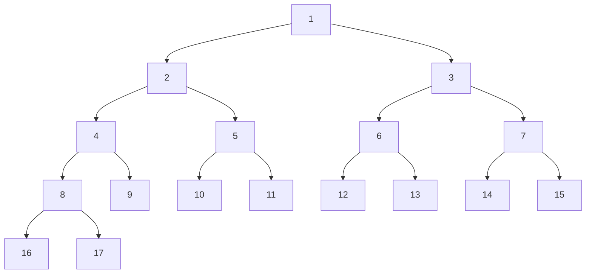

# 1. LCA, binary lifting & Ancestor Queries

## Binary lifting

Binary lifting allows us to find the `k-th ancestor` of a node in `O(log N)` time instead of `O(k)`

Imagine a rooted tree. For every node v, define:

>           up[v][j] = ancestor of v at distance 2^j

This gives you the following table:
- up[v][0] = the parent of v 
- up[v][1] = the grand parent of v
- up[v][2] = the parent of v at 4 step away
- up[v][3] = the parent of v at 8 step away

We can represent any integer `k` as a sum of powers of two.

For example:

`13 = 8 + 4 + 1`

The recurrence is:

>           up[v][j] = up[up[v][j-1]][j-1]

> [!IMPORTANT]
> Generally to get the kth ancestor, we 
>
>           walk the tree one step at a time in upward direction
>           so to get kth ancestor, we need to iterate k times
>           time complexity becomes O(k)
>
> But we can do in log time complexity
>
> for example to get the 4th ancestor
>
>       We jump two step from node and then again two step from that node
>       only two iteration required
>
> We use binary lifting for it, it requires O(logN) jumps

Therefore, to find the 13th ancestor, we jump:
1. 8 ancestors upward.
2. 4 ancestors upward.
3. 1 ancestor upward.


Consider the following rooted tree, with root node `1`.



For this example, we will calculate the binary lifting table for every node.

> [!IMPORTANT]
> The root is its own parent:
>
>           up[1][0] = 1    // for root node
>           This convention makes it easier to handle jumps that go above the root.
>
>
>           up[v][j] = the 2^j-th ancestor of node v
> Base case
>
>       The first ancestor of a node is its parent:
>
>       up[v][0] = parent[v]
>
> Recurrence
>
>       up[v][j] = up[up[v][j-1]][j-1]

### Why does this work?

To jump `2^j` edges upward:

1. Jump `2^(j-1)` edges upward.
2. From that ancestor, jump another `2^(j-1)` edges upward.

Therefore:

>       2^j = 2*2^(j-1) = 2^(j-1) + 2^(j-1)
>       This finds the 4th ancestor by jumping 2 edges twice.


### Binary Lifting Table

For the tree above, consider the following columns:

| Node | Parent (1) | 2nd ancestor | 4th ancestor | 8th ancestor | 16th ancestor |
|---:|---:|---:|---:|---:|---:|
| 1 | 1 | 1 | 1 | 1 | 1 |
| 2 | 1 | 1 | 1 | 1 | 1 |
| 3 | 1 | 1 | 1 | 1 | 1 |
| 4 | 2 | 1 | 1 | 1 | 1 |
| 5 | 2 | 1 | 1 | 1 | 1 |
| 6 | 3 | 1 | 1 | 1 | 1 |
| 7 | 3 | 1 | 1 | 1 | 1 |
| 8 | 4 | 2 | 1 | 1 | 1 |
| 9 | 4 | 2 | 1 | 1 | 1 |
| 10 | 5 | 2 | 1 | 1 | 1 |
| 11 | 5 | 2 | 1 | 1 | 1 |
| 12 | 6 | 3 | 1 | 1 | 1 |
| 13 | 6 | 3 | 1 | 1 | 1 |
| 14 | 7 | 3 | 1 | 1 | 1 |
| 15 | 7 | 3 | 1 | 1 | 1 |
| 16 | 8 | 4 | 1 | 1 | 1 |
| 17 | 8 | 4 | 1 | 1 | 1 |


The table is usually stored as:

`up[node][j]`

where `j` is the exponent, not the number of edges itself.


### Example: Find the 3rd Ancestor of Node 16

The path upward from node `16` is:

`16 -> 8 -> 4 -> 2 -> 1`

The 3rd ancestor is node `2`.

Using binary lifting:

`k = 3 = 2 + 1`

Binary representation:

`3 = (11)_2`

Therefore, we use the 2nd ancestor jump and the 1st ancestor jump.

Initially:

`node = 16`

The lowest set bit is bit 0:

`node = up[16][0] = 8`

The next set bit is bit 1:

`node = up[8][1] = 2`

Final answer:

`kthAncestor(16, 3) = 2`

Only two jumps were needed.

---

## 6. C++ Implementation

```cpp
class BinaryLifting {
public:
    int n, LOG;
    vector<vector<int>> up;
    vector<int> depth;

    BinaryLifting(int n) {
        this->n = n;
        this->LOG = 1;

        while((1LL << LOG) <= n) LOG++;

        up.resize(n, vector<int>(LOG, -1));
        depth.resize(n, 0);
    }

    void dfs(int u, int p, vector<vector<int>> &adj) {
        up[u][0] = p;

        for(int j=1; j<LOG; j++) 
            up[v][j] = up[up[v][j - 1]][j - 1];
            
        for(int v : adj[u]) {
            if(v == p) continue;

            depth[v] = depth[u] + 1;
            dfs(v, u, adj);
        }
    }

    int kthAncestor(int node, int k) {
        for(int j=0; j<LOG; j++) {
            if(k & (1LL<<j))
                node = up[node][j];
        }
        return node;
    }
};
```

### Important implementation notes

- Nodes in this implementation are indexed from `0` to `n-1`.
- Call `dfs(root, root, adj)` so that the root is its own parent.
- Ensure `adj` represents a tree and the DFS does not revisit the parent.
- For a very deep tree, use iterative DFS to avoid stack overflow.
- If `k` exceeds the node's depth, this implementation returns the root because the root is its own ancestor. Return `-1` instead if the problem requires it.

### Complexity Analysis

Let `N` be the number of nodes.

| Operation | Time Complexity |
|---|---|
| Build the ancestor table | `O(N log N)` |
| Find the k-th ancestor | `O(log N)` |
| Space for the ancestor table | `O(N log N)` |

The table contains `N` nodes and approximately `log2(N)` ancestor entries per node.

---

### Where Binary Lifting Is Useful
Once the ancestor table is built, it can be used for several tree problems:

1. **Kth ancestor:** Find the ancestor `k` edges above a node.
2. **LCA:** Find the lowest common ancestor of two nodes.
3. **Distance queries:** Use depths and LCA.
4. **Kth node on a path:** Combine LCA with ancestor jumps.
5. **Rerooted LCA:** Answer LCA queries when the root changes.
6. **Path aggregates:** Store minimum, maximum, sum, or other aggregate information for each jump.
